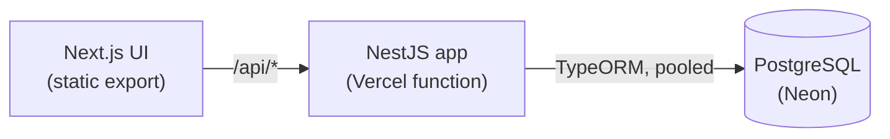

# Onboarding Flow

[](https://github.com/OWNER/onboarding-flow/actions/workflows/ci.yml)
[](https://github.com/OWNER/onboarding-flow/actions/workflows/codeql.yml)


A multi-step onboarding flow built as a full product loop: a UI that validates as you type, an API that validates every
step again, progress that survives a reload, and a funnel report that shows where people stop.

**[Live demo](https://REPLACE-WITH-YOUR-VERCEL-URL.vercel.app)** · [funnel insights](https://REPLACE-WITH-YOUR-VERCEL-URL.vercel.app/insights)

| Step 1 | Step 2 | Funnel insights |
|---|---|---|
|  |  |  |

## What is interesting here

- **The server is the source of truth.** One DTO per step, run through a pure `applyStep` function: unknown steps and
  finished sessions are refused, steps cannot be skipped, unknown fields are rejected, and input is normalised. An e2e
  test attacks the API directly to prove the UI is not the only guard.
- **Instant feedback without trusting it.** The browser repeats the field rules with zod, so errors appear immediately
  and a bad step never costs a round trip. If the two ever disagree, the server's messages are shown.
- **Resumable.** Progress is saved per step; reloading returns you to the step you reached, with your answers filled in,
  and you can go back and correct earlier steps without losing progress.
- **Race-safe.** Each save runs in a transaction with a row lock. An integration test submits the same step twice at once
  and asserts progress advances exactly once.
- **Measured.** `/insights` shows completion rate and where unfinished sessions stopped, from a single indexed query.
- **Resilient UI.** Loading, failure with retry, server errors, and an API outage are all handled and tested.
- **Production-minded API.** Fail-fast env validation, `helmet`, request IDs with redacted structured logs, rate-limited
  session creation, migrations (not `synchronize`) with a `CHECK` and a supporting index, `/api/health`, OpenAPI at
  `/api/openapi.json`.
- **Accessible.** Real labels with hints and errors wired through `aria-describedby`, focus moves to each step's heading,
  a progress list with `aria-current="step"`, live regions, visible focus, and axe checks in the e2e suite.

## Architecture



More in [docs/architecture.md](docs/architecture.md) and the [decision records](docs/adr).

| Layer | Choices |
|---|---|
| Web | Next.js 14 (App Router, static export), React 18, TypeScript, zod, self-hosted variable font |
| API | Node 20, NestJS 10, TypeORM, class-validator, pino, helmet, throttler, Swagger |
| Data | PostgreSQL 16 (JSONB progress) |
| Quality | Jest, Supertest, Playwright, axe, ESLint (jsx-a11y, react-hooks), Prettier, GitHub Actions, CodeQL, Dependabot |
| Hosting | Vercel (static + serverless function), Neon Postgres |

## Run it locally

Requires Node 20 and Docker.

```bash
docker compose up -d      # PostgreSQL, with onboarding and onboarding_test databases
npm ci
npm run db:migrate
npm run dev               # web http://localhost:3000, API http://localhost:3001/api, Swagger UI /api/docs
```

| Script | What it does |
|---|---|
| `npm run dev` | API and web app with reload |
| `npm run check` | Format check, lint, typecheck, unit tests, build |
| `npm test` / `npm run test:coverage` | Unit tests for the step rules and config |
| `npm run test:int` | API integration tests against PostgreSQL |
| `npm run e2e` | Playwright end-to-end tests (builds and starts both servers, resets the database) |
| `npm run screenshots` | Regenerates the images above into `docs/screenshots` |
| `npm run db:migrate` / `db:reset` | Apply migrations; wipe all sessions (never in production) |

## Testing strategy

| Level | What it proves | Where |
|---|---|---|
| Unit | Skipping, normalisation, unknown fields, corrections, completion | `apps/api/src/*.spec.ts` |
| Integration | Full flow over HTTP and the real database, resume, concurrency, funnel numbers | `apps/api/test/` |
| End-to-end | Happy path, client validation, resume, server errors, API outage, API bypass, accessibility | `e2e/tests/` |

CI runs three parallel jobs (quality, integration, e2e) against PostgreSQL service containers and uploads the Playwright
report on failure.

## API

All routes are under `/api`. The full contract is the OpenAPI document at `/api/openapi.json` (Swagger UI at `/api/docs`
locally).

| Method | Route | Purpose |
|---|---|---|
| POST | `/onboarding` | Start a session (rate limited) |
| GET | `/onboarding/:id` | Load progress (resume) |
| PATCH | `/onboarding/:id/steps/:step` | Validate and save one step |
| GET | `/onboarding/stats/funnel` | Completion rate and drop-off per step |
| GET | `/health` | Liveness, including the database |

Validation failures return `400 { "message": ["...", "..."] }` with every problem on the step.

## Deploy to Vercel

1. Push the repo to GitHub and import it in Vercel. Set **Framework Preset** to *Other*. The build settings come from
   [`vercel.json`](vercel.json).
2. In the project, open **Storage** (Marketplace) and add **Neon Postgres**. This sets `DATABASE_URL` for production
   and creates an isolated database branch for each preview deployment.
3. No other variables are needed: this app has no accounts or secrets.
4. Deploy. The build compiles the API, runs migrations, builds the Next.js static export, and publishes `/api` as a
   function.
5. Put the live URL at the top of this README and replace `OWNER` in the badges.

## Decisions and trade-offs

- [Validation on the server, mirrored in the browser](docs/adr/0001-validation-on-the-server.md)
- [JSONB progress and row locking](docs/adr/0002-jsonb-progress-and-row-locking.md)
- [Anonymous sessions and their limits](docs/adr/0003-anonymous-sessions.md)
- [Static export and one Vercel project](docs/adr/0004-static-export-and-one-vercel-project.md)


## License

[MIT](LICENSE)
