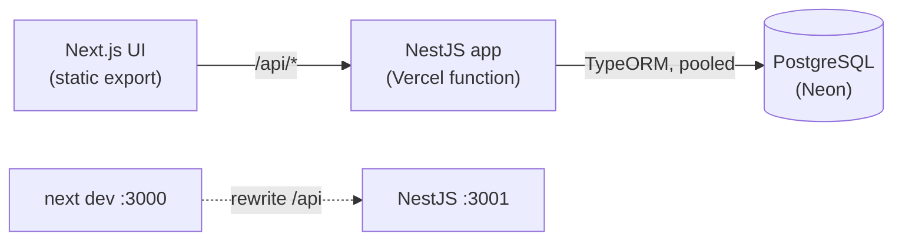
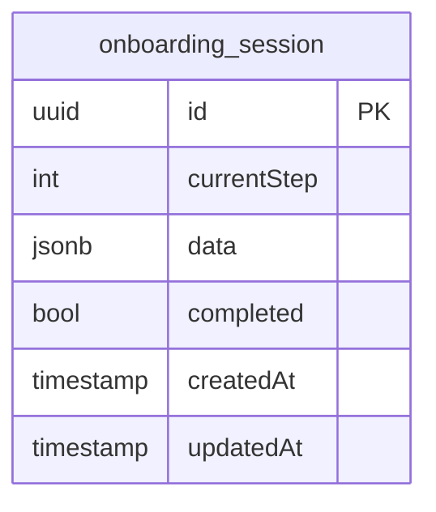

# Architecture

## Runtime



## Data model



`data` holds one object per step, for example `{ "step1": { "fullName": "...", "email": "..." }, "step2": { ... } }`.

## Saving a step

```mermaid
sequenceDiagram
  participant UI as Next.js
  participant API as NestJS
  participant DB as PostgreSQL
  UI->>UI: validate with zod (instant feedback)
  UI->>API: PATCH /api/onboarding/:id/steps/2
  API->>DB: BEGIN, SELECT ... FOR UPDATE
  API->>API: applyStep: step exists, not skipped, DTO valid, no unknown fields
  alt invalid
    API-->>UI: 400 { message: [...] }
  else valid
    API->>DB: UPDATE data, currentStep; COMMIT
    API-->>UI: 200 session
  end
```

## Where things live

| Concern | Location |
|---|---|
| Per-step rules (DTOs) | `apps/api/src/onboarding/step.dto.ts` |
| Step transition logic (pure, unit-tested) | `apps/api/src/onboarding/onboarding.rules.ts` |
| Persistence, row lock, funnel query | `apps/api/src/onboarding/onboarding.service.ts` |
| Schema | `apps/api/src/migrations`, wired in `data-source.ts` |
| Vercel function entry | `api/index.js` → `apps/api/src/serverless.ts` |
| UI: flow, stepper, form, insights | `apps/web/app`, `apps/web/components`, `apps/web/lib` |
| Tests | unit `apps/api/src/*.spec.ts`, integration `apps/api/test/`, e2e `e2e/tests/` |
